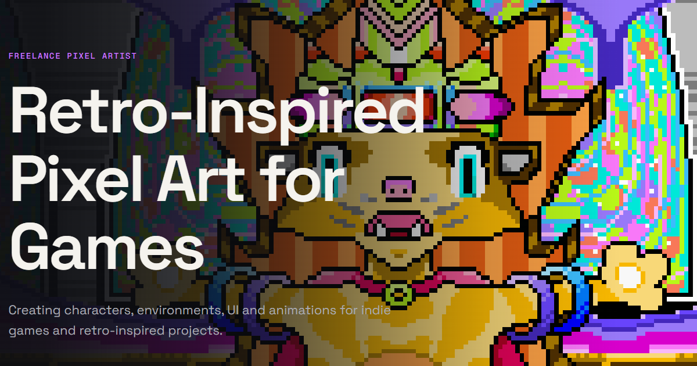

# Noisechip — Pixel Art Portfolio

Official portfolio website for **Noisechip**, a freelance pixel artist creating retro-inspired artwork for video games.

Built with **Next.js, React, TypeScript and Tailwind CSS**, this website showcases pixel art, game projects and freelance services through responsive galleries, interactive image viewers and dedicated project pages.



**Live website:** [noisechip.com](https://noisechip.com/)

---

## Overview

Noisechip is a professional pixel art portfolio designed to present artwork at a comfortable viewing size while keeping projects, services and contact information easy to explore.

The website was rebuilt from the ground up using the Next.js App Router, replacing the previous implementation with a component-based architecture, structured content and an automated deployment workflow.

The project also serves as a practical frontend development portfolio, with an emphasis on maintainability, responsive design, accessibility, SEO and production deployment.

## Key Features

### Artwork Gallery

The **Work** section presents artwork across several categories:

- Characters
- Animations
- UI
- Environments
- Sprites and Props
- Tiles and Backgrounds
- Mockups

Artwork is displayed in responsive galleries with an interactive lightbox, allowing visitors to explore images at a larger size without leaving the page.

### Game Projects

The **Projects** section features selected game-related work with individual detail pages:

- Retro Platformer
- Retro Puzzle
- Retro Casual Memory
- Retro Casual Arcade

Project information and media are organized separately from reusable UI components to simplify maintenance and future additions.

### Responsive Interface and Themes

- Responsive layouts for desktop, tablet and mobile
- Light and dark appearance modes
- Adaptive navigation and artwork grids
- Dedicated image viewers for work and project media
- Consistent spacing, typography and visual hierarchy
- Mobile layout reviews, including a 390 px viewport

### About and Contact

The website includes an **About** page introducing Noisechip's work and services, and a **Contact** page for freelance inquiries, commissions and collaborations.

## Architecture and Technologies

The frontend is built with the **Next.js App Router** and uses static export to generate files that can be hosted without a continuously running Node.js server.

| Area | Technologies and tools |
| --- | --- |
| Framework | Next.js 16, React 19 |
| Language | TypeScript |
| Styling | Tailwind CSS, CSS |
| Architecture | App Router, reusable React components, structured data and types |
| Quality | ESLint, responsive and accessibility reviews |
| Version control | Git, GitHub |
| CI/CD | GitHub Actions |
| Hosting | GoDaddy Web Hosting, Apache |
| Deployment | SSH, rsync |

### Project Structure

Simplified overview of the repository:

```text
noisechip-portfolio/
├── .github/
│   └── workflows/
│       └── deploy.yml
├── public/
│   ├── branding/
│   ├── icons/
│   ├── projects/
│   ├── work/
│   └── preview.png
├── src/
│   ├── app/
│   │   ├── about/
│   │   ├── contact/
│   │   ├── projects/
│   │   ├── work/
│   │   ├── globals.css
│   │   ├── layout.tsx
│   │   └── page.tsx
│   ├── components/
│   ├── data/
│   └── types/
├── AGENTS.md
├── CLAUDE.md
├── next.config.ts
├── package.json
├── package-lock.json
├── tsconfig.json
└── README.md
```

- **`src/app/`** contains routes, layouts and application-level styles.
- **`src/components/`** contains reusable interface components.
- **`src/data/`** contains portfolio and project content.
- **`src/types/`** contains shared TypeScript definitions.
- **`public/`** contains branding, icons, artwork and project media.
- **`.github/workflows/deploy.yml`** defines the automated deployment workflow.

## Contact Form and Security

The frontend is statically generated. Contact form requests are handled by a **server-side PHP endpoint** hosted separately from the Next.js application.

The production PHP endpoint and its server-side configuration are **not included in this public repository**. Private credentials and deployment keys must remain outside version control.

This separation keeps the public frontend compatible with static hosting while allowing the production server to process contact requests.

## SEO and Accessibility

The project includes technical SEO configuration and usability improvements, including:

- Page-specific titles and descriptions
- Canonical URLs using `https://noisechip.com/`
- Open Graph and social sharing metadata
- XML sitemap and `robots.txt`
- Favicons and application icons
- Descriptive page and project routes
- Semantic page structure and heading hierarchy
- Alternative text for artwork
- Keyboard and focus-state considerations for interactive elements
- Responsive presentation across different viewport sizes

The sitemap is available at [noisechip.com/sitemap.xml](https://noisechip.com/sitemap.xml) and includes the five main pages and four project detail pages.

Google Search Console is used to monitor sitemap processing, crawling and indexing. Search engine indexing is managed by Google and is not guaranteed by submitting a sitemap.

## Performance and Static Export

The website is configured for **static export**, generating deployable frontend files in the `out/` directory during the production build.

This architecture offers several benefits:

- No continuously running Next.js server is required in production.
- Static files can be served directly by the hosting web server.
- Frontend deployment is compatible with the existing GoDaddy hosting environment.
- Content and layout changes can be validated locally before publication.

Artwork presentation, image loading, responsive behavior and usability were reviewed during development, with particular care taken to preserve the appearance of pixel art.

## CI/CD and Deployment

Production deployment is automated through **GitHub Actions**, using **SSH and rsync** to publish the static output to GoDaddy.

```text
Push to the deployment branch
              |
              v
        GitHub Actions
              |
              v
    Install dependencies
              |
              v
      Build Next.js app
              |
              v
     Static output: out/
              |
              v
         SSH + rsync
              |
              v
      GoDaddy Web Hosting
              |
              v
     https://noisechip.com/
```

The deployment workflow avoids manual FTP uploads for routine frontend updates. Connection credentials are configured outside the public source code through GitHub Actions secrets.

The website uses HTTPS and the non-`www` domain as its canonical public address. Apache configuration handles the relevant production redirects.

## Local Development

### Requirements

- Node.js
- npm
- Git

### Clone the Repository

```bash
git clone https://github.com/alejandroarevaloprogrammer/noisechip-portfolio.git
cd noisechip-portfolio
```

### Install Dependencies

```bash
npm install
```

### Start the Development Server

```bash
npm run dev
```

Open [http://localhost:3000](http://localhost:3000) in your browser.

### Build for Production

```bash
npm run build
```

The static production output is generated in `out/`.

**Note:** The production PHP contact endpoint is not part of this repository, so its server-side functionality cannot be reproduced using only the frontend source code.

## Development Process

The website was developed in three main phases.

### Phase 1 — Functional Foundation

- Configure Next.js, TypeScript and the App Router.
- Establish the main routes and reusable components.
- Organize artwork, project content and shared types.
- Implement the initial galleries, project pages and lightbox interactions.
- Validate static export and the initial asset structure.

### Phase 2 — Visual Direction

- Refine global layout, spacing and typography.
- Review the header, navigation and homepage.
- Polish Work, Projects, project detail, About and Contact pages.
- Review lightbox presentation and interaction.
- Validate light and dark themes.
- Check responsive layouts, including mobile views.

### Phase 3 — Final Review and Publication

- Review accessibility and interaction details.
- Refine responsive behavior and performance.
- Configure technical SEO, metadata, sitemap and robots rules.
- Prepare branding icons and social preview metadata.
- Configure production hosting and redirects.
- Implement and verify automated GitHub Actions deployment.
- Submit the updated sitemap and request indexing in Google Search Console.

## What I Learned

Developing and publishing Noisechip provided practical experience with:

- Structuring a complete frontend application with the Next.js App Router
- Designing reusable React components and TypeScript content models
- Maintaining a consistent interface across light and dark themes
- Building responsive galleries and image viewing interactions
- Presenting pixel art without compromising its visual character
- Reviewing accessibility, usability and responsive behavior
- Preparing canonical URLs, metadata and search engine resources
- Deploying a statically exported Next.js site to traditional web hosting
- Automating production releases with GitHub Actions, SSH and rsync
- Maintaining a live website and monitoring search engine indexing

## Copyright and Usage

The source code is publicly visible for portfolio and educational reference. **Public availability does not grant permission to reuse or redistribute the code or assets.**

Unless otherwise stated, original pixel art, illustrations, animations, branding and other visual assets displayed on the website belong to Noisechip and may not be reused, redistributed or incorporated into other projects without permission.

No open-source license is granted by this README.

## Author

**Alejandro Arevalo Rojas**  
Front-End Developer

- [Portfolio](https://www.alejandroarevalorojas.com/)
- [GitHub](https://github.com/alejandroarevaloprogrammer)
- [LinkedIn](https://www.linkedin.com/in/alejandro-ar%C3%A9valo-rojas-755335365/)

## About Noisechip

**Noisechip** creates retro-inspired pixel art for indie games and related projects, including characters, environments, UI, animations and other game-ready artwork.

Available for freelance work, commissions and long-term collaborations.

- **Website:** [noisechip.com](https://noisechip.com/)
- **Instagram / X:** `@noisechip`
